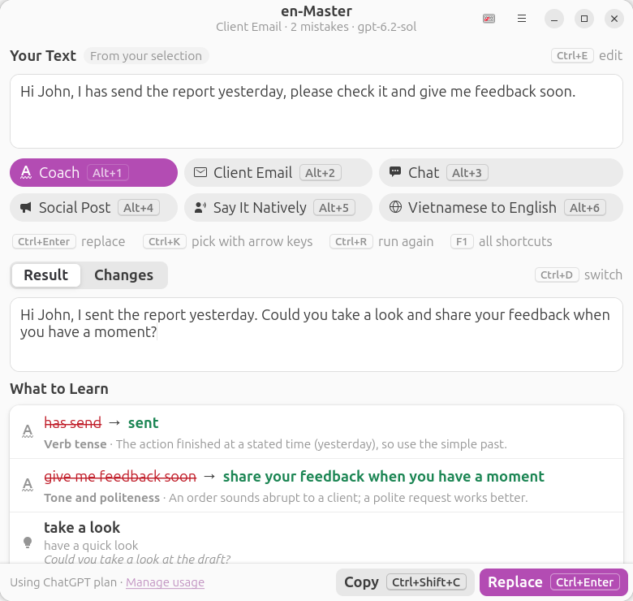

<div align="center">
  

  # en-Master

  Practise English writing on the text you write

  
</div>

Select text in any app, press <kbd>Super</kbd>+<kbd>Alt</kbd>+<kbd>C</kbd>, and en-Master shows a
corrected version, every change word by word, and a short explanation of each mistake in your own
language. Your mistakes go into a learning log that feeds a progress report, daily drills with
spaced repetition, and an Anki export.

en-Master uses your **ChatGPT plan** through OpenAI's
[Sign in with ChatGPT for open-source apps](https://developers.openai.com/siwc/token-sharing-open-source),
so no API key is needed. Your text is sent to OpenAI only when you run an action.

[Tiếng Việt](README.vi.md)

## Features

- Actions for coaching, client emails, chat messages, social posts, natural phrasing and
  Vietnamese to English, plus your own
- A word-by-word view of every change, and what to learn from it
- Progress over 7, 30 or 90 days: mistake types, mistakes you repeat, phrases to remember
- Daily drills of your own past mistakes, with a reminder notification
- Fully usable from the keyboard; press <kbd>F1</kbd> for every shortcut
- Adaptive layout down to 360 pixels wide, light and dark styles, Vietnamese translation

## Keyboard

| Anywhere in GNOME | |
|---|---|
| <kbd>Super</kbd>+<kbd>Alt</kbd>+<kbd>C</kbd> | Coach the selected text |
| <kbd>Super</kbd>+<kbd>Alt</kbd>+<kbd>E</kbd> | Open en-Master on the selected text |
| <kbd>Super</kbd>+<kbd>Alt</kbd>+<kbd>D</kbd> | Daily drill |

In the window: <kbd>Alt</kbd>+<kbd>1</kbd>…<kbd>9</kbd> run an action, <kbd>Ctrl</kbd>+<kbd>Enter</kbd> runs
Coach and then replaces your text, <kbd>Ctrl</kbd>+<kbd>D</kbd> shows the changes, <kbd>Esc</kbd> cancels
or closes.

## Install

### Flatpak

```sh
# Generate the offline crate list (needs network; uses flatpak-builder-tools)
uv run --script https://raw.githubusercontent.com/flatpak/flatpak-builder-tools/master/cargo/flatpak-cargo-generator.py \
  Cargo.lock -o build-aux/cargo-sources.json
flatpak-builder --user --install --force-clean build-flatpak build-aux/io.github.tecix.eng_master.json
flatpak run io.github.tecix.eng_master
```

Inside Flatpak, global shortcuts come from the GlobalShortcuts portal (GNOME asks you to confirm
them the first time) and the daily reminder uses the Background portal.

### From source, without Flatpak

Needs Rust, GTK 4.20, libadwaita 1.9 and gettext. `xsel` reads the selection without focus, and
`ydotool` is optional for pasting results back.

```sh
cargo build --release
./target/release/enmaster install
```

`install` copies the binary to `~/.local/bin` and adds the desktop entry, icons, translations,
an autostart entry for reminders, and the three GNOME custom shortcuts. `enmaster uninstall`
removes them and keeps your data.

## Privacy

- The ChatGPT connection is stored in the GNOME keyring.
- The learning log (`~/.local/share/enmaster/log.jsonl`) keeps your mistakes and phrases; full
  texts only if you turn on **Keep Full Texts**.
- Requests use `store: false`, and count toward your ChatGPT plan's usage limits, which you
  can cap per app under [Manage usage](https://chatgpt.com/settings/usage).

## Contributing

Bug reports and pull requests are welcome. See [ARCHITECTURE.md](ARCHITECTURE.md) for how the
code fits together, and run `cargo test` and `cargo clippy` before sending changes.
Translations live in `po/`; run `po/update.sh` after changing strings.

This project follows the [GNOME Code of Conduct](CODE_OF_CONDUCT.md).

## License

GPL-3.0-or-later. See [COPYING](COPYING).
